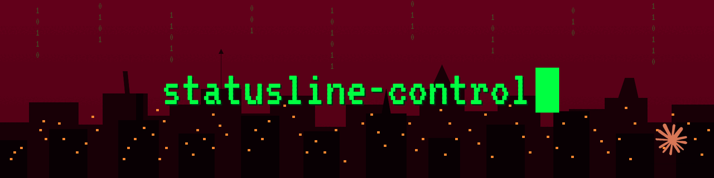

<div align="center">



**English** · [Português](./README.pt-BR.md)

**Everything you need at a glance — directory, branch, model, context, rate limits with countdown, and open PR — all on a single colored line.**

For [Claude Code](https://docs.claude.com/en/docs/claude-code).

[](./LICENSE)
[](./statusline-command.sh)
[](https://docs.claude.com/en/docs/claude-code)
[](https://github.com/lfsp-git/statusline-control/pulls)

</div>

---

## Preview

```text
📁 my-project │ 🌿 main* │ 🤖 Opus 4.7 │ 📊 42%/200k │ ⏱ 3h 14m (28%) │ 📅 2d 5h (61%) │ 🔀 PR #142
```

Percentage colors adapt automatically: **green** < 60% · **yellow** ≥ 60% · **red** ≥ 85%. A segment that doesn't apply right now (no branch, no PR, no vim mode) simply disappears.

---

## What it shows

| | Segment | What it displays |
|:-:|---|---|
| 📁 | **dir** | Current directory name |
| 🌿 | **branch** | Git branch — with `*` when there are uncommitted changes |
| 🤖 | **model** | Model in use (Opus / Sonnet / Haiku / Fable…) |
| 📊 | **context** | % of context used + window size, colored by threshold |
| ⏱ | **5h window** | 5-hour rate limit: countdown to reset + % used |
| 📅 | **weekly** | Weekly rate limit: countdown to reset + % used |
| 🔀 | **PR / MR** | Associated PR (GitHub) or MR (GitLab) number |
|  | **style** | Output style, only when different from `default` |
|  | **vim** | Current mode, when vim mode is on |

---

## ✨ Features

- **Zero heavy dependencies** — bash + `jq` + `tput`. Nothing else.
- **Fail-open by design** — a broken field never takes down the entire statusline.
- **Rate limits snapshot on disk** — every render writes `~/.claude/rate_limits.json` so a running session can read it and pace itself.
- **Adaptive colors** — context and rate limits turn yellow at 60% and red at 85% with no setup.
- **Hackable** — a single ~160-line file, made to be edited.

---

## Installation

### 1. Install `jq` (if you don't already have it)

```bash
# Debian / Ubuntu / WSL
sudo apt install jq

# macOS
brew install jq

# Arch
sudo pacman -S jq
```

### 2. Clone the repo

```bash
git clone https://github.com/lfsp-git/statusline-control.git ~/.claude/statusline-control
chmod +x ~/.claude/statusline-control/statusline-command.sh
```

### 3. Point Claude Code to the script

In `~/.claude/settings.json`:

```json
{
  "statusLine": {
    "type": "command",
    "command": "~/.claude/statusline-control/statusline-command.sh"
  }
}
```

### 4. Reload

Run `/statusline` inside Claude Code, or restart the session.

> 💡 **Tip** — if `~` doesn't expand in your setup, swap it for an absolute path (e.g. `/home/your-user/.claude/statusline-control/statusline-command.sh`).

---

## Customization

The script is a single bash file made to be hacked. Most common edits:

<table>
<tr>
<td width="33%">

**🎨 Change the colors**

Edit the `tput setaf <n>` lines at the top. Numbers: `0–7` basic, `8–15` bright. Or paste raw ANSI codes directly.

</td>
<td width="33%">

**➖ Remove a segment**

Each segment is an `if ... segments+=(...)` block. Comment the whole block — the rest adjusts itself.

</td>
<td width="33%">

**😀 Change the emojis**

Edit the strings inside each `segments+=`. E.g. `📁` → `` for the directory.

</td>
</tr>
<tr>
<td>

**🎯 Change the thresholds**

Search for `-ge 85` and `-ge 60` — those are the red and yellow cutoffs for context and rate limits.

</td>
<td>

**│ Change the separator**

Edit `out="$out ${GRAY}│${RESET} $s"`. Favorites: `•`, `|`, `·`, `»`.

</td>
<td>

**➕ Add a segment**

`jq -r '.new.field'` from stdin → conditional color → `segments+=("${COLOR}... ${RESET}")`.

</td>
</tr>
</table>

The JSON schema Claude Code pipes in is in the [official docs](https://docs.claude.com/en/docs/claude-code/statusline).

---

## 🔎 Bonus: why dump rate limits to disk?

The Claude Code harness pipes rate-limit fields to the statusline on every render, but **a session running inside Claude Code cannot read those fields from within a tool call** — they only surface on the display.

On every render the script also writes the rate limits to `~/.claude/rate_limits.json`:

```json
{
  "captured_at": "2026-10-19T15:42:03Z",
  "five_hour":  { "used_percentage": 28, "resets_at": 1760889723 },
  "seven_day":  { "used_percentage": 61, "resets_at": 1761062523 },
  "model": "Opus 4.7",
  "session_id": "…"
}
```

With that, a session can pace itself with a plain `cat ~/.claude/rate_limits.json` instead of discovering the limit by hitting a 429 mid-round. If you don't want this behavior, delete the block between the `--- persist the rate-limit window ---` comments in the script.

---

## Requirements

| Tool | For | Required? |
|---|---|:-:|
| `bash` | The script itself | ✅ |
| [`jq`](https://jqlang.github.io/jq/) | Parse the JSON from stdin | ✅ |
| `tput` | Colors (ships with `ncurses`) | ✅ |
| `git` | Branch segment | optional |

---

## Troubleshooting

<details>
<summary><b>Blank statusline</b></summary>

`jq` is probably not installed. Check with `jq --version`. If it says "command not found", go back to the installation section.
</details>

<details>
<summary><b>No colors</b></summary>

Your terminal may not support 256 colors, or `TERM` is misconfigured. Test with `tput colors` — it should return `256` or more. If it returns `8`, use only the basic color codes (`0–7`).
</details>

<details>
<summary><b>Branch doesn't show up</b></summary>

The script uses `--no-optional-locks` so it doesn't fight a running `git`. In very large repos the segment may stay empty on some cycles — that's fail-open by design. It also naturally disappears outside a git repo.
</details>

<details>
<summary><b>Rate limits don't show</b></summary>

You probably haven't hit the limits in the current session yet. Claude Code only sends those fields after the first real use of the window.
</details>

<details>
<summary><b><code>rate_limits.json</code> isn't being written</b></summary>

Make sure `~/.claude/` exists and is writable. The write is fail-open — if it fails, the statusline keeps rendering normally with no visible error.
</details>

---

<div align="center">

**MIT License · Do whatever you want · [Issues](https://github.com/lfsp-git/statusline-control/issues) · [PRs](https://github.com/lfsp-git/statusline-control/pulls) welcome**

<sub>Made with ☕ and way too much time staring at the statusline.</sub>


</div>
