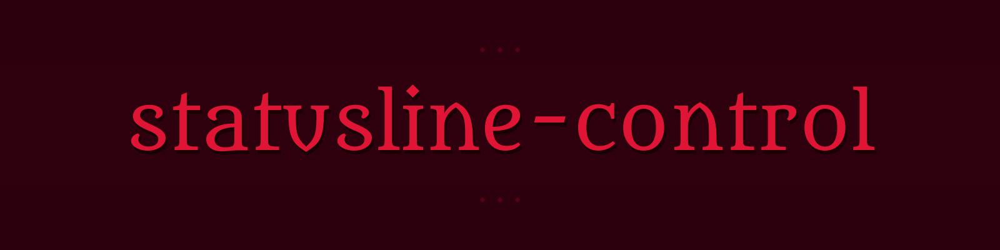

<div align="center">



**Tudo que importa de relance — diretório, branch, modelo, contexto, rate limits com contagem regressiva e PR aberto, em uma única linha colorida.**

Para o [Claude Code](https://docs.claude.com/en/docs/claude-code).

[](./LICENSE)
[](./statusline-command.sh)
[](https://docs.claude.com/en/docs/claude-code)
[](https://github.com/lfsp-git/statusline-control/pulls)

</div>

---

## Preview

```text
📁 my-project │ 🌿 main* │ 🤖 Opus 4.7 │ 📊 42%/200k │ ⏱ 3h 14m (28%) │ 📅 2d 5h (61%) │ 🔀 PR #142
```

As cores dos % mudam sozinhas: **verde** < 60% · **amarelo** ≥ 60% · **vermelho** ≥ 85%. Se um segmento não faz sentido naquele momento (sem branch, sem PR, sem vim mode), ele simplesmente some.

---

## O que aparece

| | Segmento | O que mostra |
|:-:|---|---|
| 📁 | **dir** | Nome do diretório atual |
| 🌿 | **branch** | Branch git — com `*` quando há mudanças não commitadas |
| 🤖 | **model** | Modelo em uso (Opus / Sonnet / Haiku / Fable…) |
| 📊 | **context** | % do contexto usado + tamanho da janela, colorido por faixa |
| ⏱ | **5h window** | Rate limit de 5h: contagem regressiva até o reset + % usado |
| 📅 | **weekly** | Rate limit semanal: contagem regressiva até o reset + % usado |
| 🔀 | **PR / MR** | Número do PR (GitHub) ou MR (GitLab) associado |
|  | **style** | Output style, só quando diferente de `default` |
|  | **vim** | Modo atual, quando vim mode está ligado |

---

## ✨ Features

- **Zero dependências pesadas** — bash + `jq` + `tput`. Nada mais.
- **Fail-open por desenho** — um campo quebrado nunca derruba a statusline inteira.
- **Snapshot de rate limits em disco** — a cada render grava `~/.claude/rate_limits.json`, para que a própria sessão possa ler e se auto-regular.
- **Cores adaptativas** — contexto e rate limits viram amarelo em 60% e vermelho em 85% sem configuração.
- **Hackeável** — um único arquivo de ~160 linhas, feito pra editar.

---

## Instalação

### 1. Instale o `jq` (se ainda não tem)

```bash
# Debian / Ubuntu / WSL
sudo apt install jq

# macOS
brew install jq

# Arch
sudo pacman -S jq
```

### 2. Clone o repo

```bash
git clone https://github.com/lfsp-git/statusline-control.git ~/.claude/statusline-control
chmod +x ~/.claude/statusline-control/statusline-command.sh
```

### 3. Aponte o Claude Code para o script

Em `~/.claude/settings.json`:

```json
{
  "statusLine": {
    "type": "command",
    "command": "~/.claude/statusline-control/statusline-command.sh"
  }
}
```

### 4. Recarregue

Rode `/statusline` dentro do Claude Code, ou reinicie a sessão.

> 💡 **Dica** — se `~` não expandir no seu setup, troque por caminho absoluto (ex: `/home/seu-user/.claude/statusline-control/statusline-command.sh`).

---

## Customização

O script é um único arquivo bash pensado para ser hackeado. Os pontos mais comuns:

<table>
<tr>
<td width="33%">

**🎨 Mudar as cores**

Edite as linhas de `tput setaf <n>` no topo. Números: `0–7` básico, `8–15` bright. Ou cole códigos ANSI direto.

</td>
<td width="33%">

**➖ Remover um segmento**

Cada segmento é um `if ... segments+=(...)`. Comente o bloco inteiro — o resto se ajusta sozinho.

</td>
<td width="33%">

**😀 Trocar os emojis**

Edite as strings dentro de cada `segments+=`. Ex: `📁` → `` para o diretório.

</td>
</tr>
<tr>
<td>

**🎯 Mudar os thresholds**

Procure por `-ge 85` e `-ge 60` — são os cortes para vermelho e amarelo em contexto e rate limits.

</td>
<td>

**│ Trocar o separador**

Edite `out="$out ${GRAY}│${RESET} $s"`. Favoritos: `•`, `|`, `·`, `»`.

</td>
<td>

**➕ Adicionar segmento**

`jq -r '.novo.campo'` do stdin → cor condicional → `segments+=("${COR}... ${RESET}")`.

</td>
</tr>
</table>

O schema do JSON que o Claude Code pipeia está [na documentação oficial](https://docs.claude.com/en/docs/claude-code/statusline).

---

## 🔎 Bônus: por que gravar os rate limits em disco?

O harness do Claude Code pipeia os campos de rate limit para a statusline a cada render, mas **uma sessão rodando dentro do Claude Code não consegue ler esses campos de dentro de uma tool call** — eles só aparecem no display.

A cada render, o script também grava os rate limits em `~/.claude/rate_limits.json`:

```json
{
  "captured_at": "2026-10-19T15:42:03Z",
  "five_hour":  { "used_percentage": 28, "resets_at": 1760889723 },
  "seven_day":  { "used_percentage": 61, "resets_at": 1761062523 },
  "model": "Opus 4.7",
  "session_id": "…"
}
```

Com isso, uma sessão pode se auto-regular com um simples `cat ~/.claude/rate_limits.json` em vez de descobrir o limite batendo num 429 no meio de um round. Se não quiser esse comportamento, apague o bloco entre `--- persist the rate-limit window ---` no script.

---

## Requisitos

| Ferramenta | Para quê | Obrigatório? |
|---|---|:-:|
| `bash` | O script em si | ✅ |
| [`jq`](https://jqlang.github.io/jq/) | Parsear o JSON do stdin | ✅ |
| `tput` | Cores (vem com `ncurses`) | ✅ |
| `git` | Segmento de branch | opcional |

---

## Troubleshooting

<details>
<summary><b>Statusline em branco</b></summary>

Provavelmente `jq` não está instalado. Confirme com `jq --version`. Se der "command not found", volte para a seção de instalação.
</details>

<details>
<summary><b>Sem cores</b></summary>

Seu terminal pode não suportar 256 cores, ou `TERM` está mal configurado. Teste com `tput colors` — deve retornar `256` ou mais. Se retornar `8`, use só os códigos de cor básicos (`0–7`).
</details>

<details>
<summary><b>Branch não aparece</b></summary>

O script usa `--no-optional-locks` para não brigar com um `git` já em execução. Em repos muito grandes, o segmento pode ficar vazio em alguns ciclos — é fail-open por desenho. Também some fora de um repo git, naturalmente.
</details>

<details>
<summary><b>Rate limits não aparecem</b></summary>

Você provavelmente ainda não bateu nos limites na sessão atual. O Claude Code só manda esses campos depois do primeiro uso real da janela.
</details>

<details>
<summary><b>O arquivo <code>rate_limits.json</code> não está sendo gerado</b></summary>

Verifique se `~/.claude/` existe e é gravável. O write é fail-open — se falhar, a statusline continua renderizando normalmente, sem erro visível.
</details>

---

<div align="center">

**Licença MIT · Faça o que quiser · [Issues](https://github.com/lfsp-git/statusline-control/issues) · [PRs](https://github.com/lfsp-git/statusline-control/pulls) são bem-vindos**

<sub>Feito com ☕ e tempo demais olhando para a statusline.</sub>


</div>
